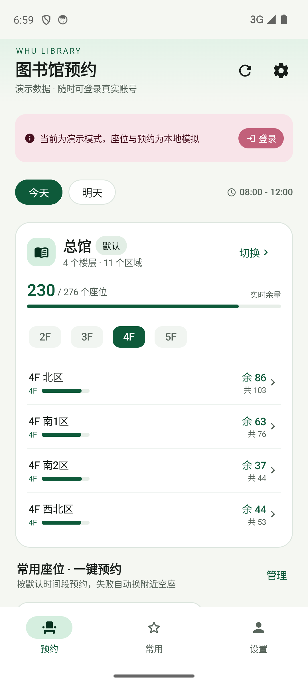
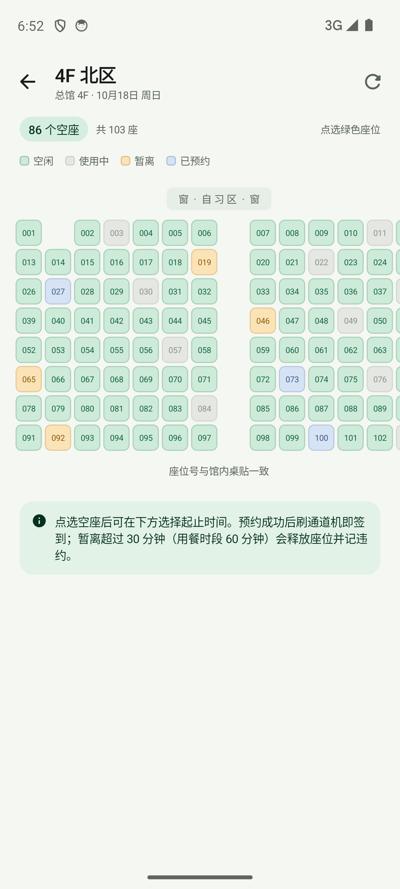
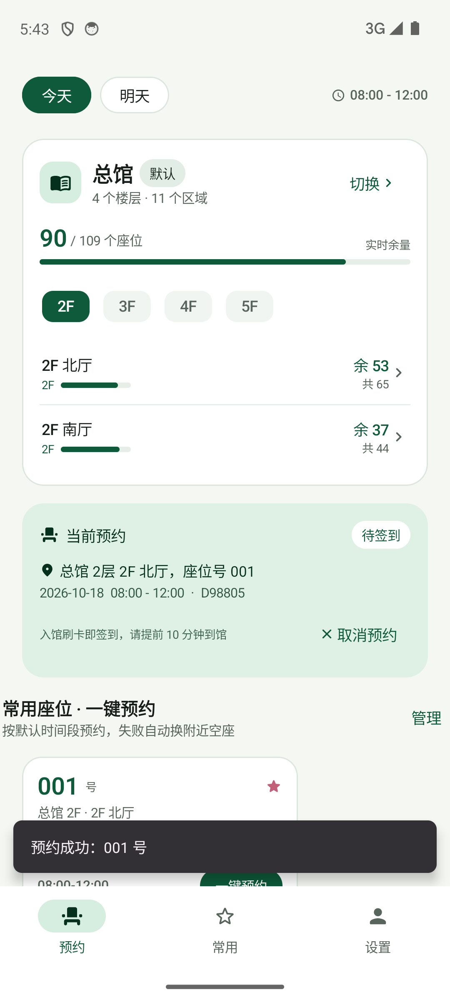
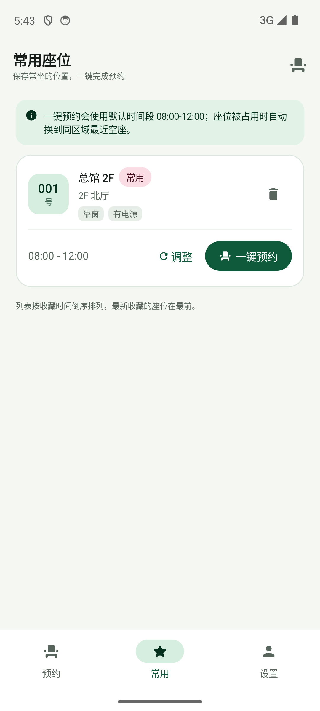
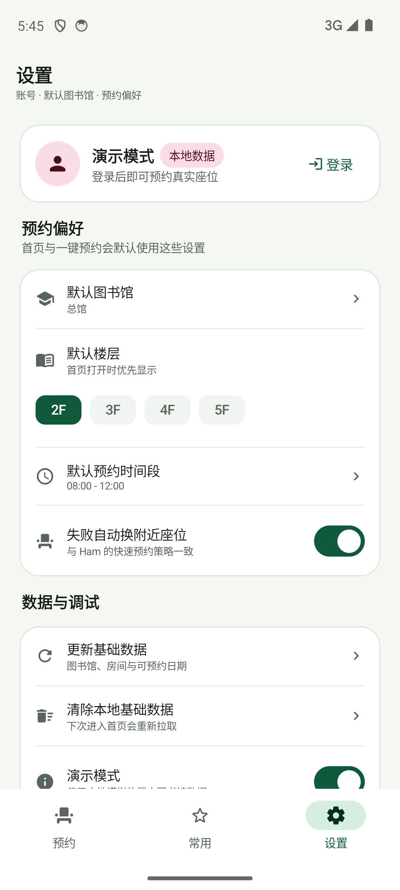
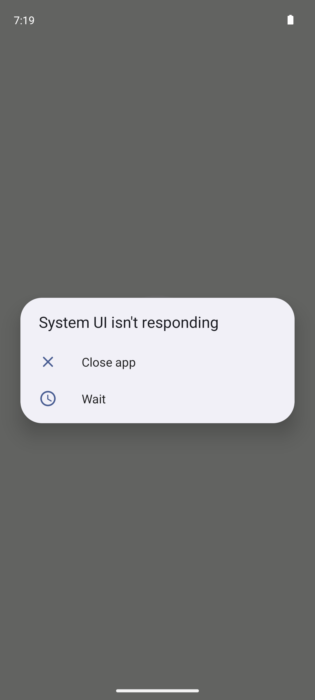

# 珞珈座位 · WHU Library Seat

[](LICENSE)
[](../../releases/latest)
[](https://developer.android.com)

武汉大学图书馆座位预约 Android 客户端。打开即进入预约首页，支持默认图书馆 / 楼层、座位看板、常用座位一键预约，以及 WebView 信息门户登录（手动完成图片验证码）。

> 本项目复用了 [whu-ham/whu-ham.github.io](https://github.com/whu-ham/whu-ham.github.io) 所描述的图书馆预约业务逻辑，以及 seat.lib.whu.edu.cn 的座位系统接口约定；UI 与数据层为原生 Android 重写。

## 下载

前往 [Releases](../../releases/latest) 下载 `whu-library-seat-v1.0.apk` 安装即可（Android 8.0 及以上）。

> 首次安装需在系统设置中允许「安装未知来源应用」。APK 使用项目自签名证书，与后续版本保持一致，可直接覆盖升级。



## 功能

- **首页即预约入口**：日期切换、实时余量、房间入口都在首屏；「常用预约」卡片置顶，点卡片即可预约。
- **常用座位 · 快速预约**：点常用座位卡片先选开始/结束时间段，确认后预约；座位被占时自动换到附近空座（换座会再次弹出滑块验证，弹窗内有文字提示）。
- **桌面小部件 · 快速预约**：4×3 小部件，顶部显示默认馆整馆的「已约 / 总量」与余量进度条，下方直接在桌面选常用座位、按 30 分钟步进调开始/结束时间，点「预约」即提交；最后一步的官方滑块验证由 App 内的验证卡片完成，无需再进首页。
- **看板预约**：图书馆 → 楼层 → 区域 → 座位图选座，支持起止时间、收藏、预约。
- **座位属性标识**：座位图里靠窗座位左缘有蓝色竖条、有电源座位带 ⚡ 角标，图例有对照；快速预约弹窗同样显示。
- **已有预约管理**：座位图页顶部展示当前预约（位置 + 时间段），可直接取消（带二次确认）；预约成功 / 失败均以对话框明确提示，不再被卡片遮挡。
- **预约统计**（设置 → 预约统计）：基于座位系统官方预约记录，提供总次数、总使用时长，每周 / 每月 / 每年预约总时长折线图，以及常用座位次数 / 时长排行。
- **常用卡片使用统计**：常用座位卡片显示近一年该座位的预约次数与总时长。
- **登录保持（静默续期）**：token 有效期约 30 分钟且不可续期；用「统一身份认证登录」一次后，App 会在 token 过期时自动走统一认证 SSO 静默换新，关闭 / 重开 App 都无需重新登录（「图书馆认证登录」暂不支持静默续期）。
- **WebView 登录**：打开座位系统官方登录页完成账号密码 + 图片验证码，或走统一身份认证；App 只捕获登录后的 token，不接触密码。
- **运行日志**（设置 → 运行日志）：记录验证码 WebView、接口与登录续期全过程，支持查看 / 复制 / 分享，方便反馈问题。
- **演示模式**：没有账号也能完整体验选座、预约、收藏、取消的交互。

## 与 Ham 仓库的关系

`whu-ham/whu-ham.github.io` 是 VitePress **文档站**，仓库内没有 App 源码；其关联仓库 `ham-rn`、`ham-web`、`ham-open-proto` 也不包含图书馆模块的实现。因此本项目复用的是：

1. `docs/src/guide/handbook/library.md` 描述的**产品逻辑**：看板预约、快速预约、首选座位、预约状态、历史、基础数据缓存；
2. Ham 对接的**经典座位系统 REST 协议**：`/rest/auth`、`/rest/v2/free/filters`、`/rest/v2/room/stats2`、`/rest/v2/room/layoutByDate`、`/rest/v2/freeBook`、`/rest/v2/user/reservations`、`/rest/v2/cancel`、`/rest/v2/history`。

完整的复用清单、改动范围与新增结构见 **[docs/复用与改动说明.md](docs/复用与改动说明.md)**。

## 登录（WebView）

座位系统已升级为带图片验证码的新版前端，原生表单无法稳定完成认证，因此登录改为和 Ham 相同的“网页内登录”方案：

```
首页「登录」→ WebView 打开 https://seat.lib.whu.edu.cn/seat/#/login
    → 用户输入读者证号/密码 + 图片验证码（或点“统一身份认证”）
    → 登录成功，SPA 将 token 写入 sessionStorage（key 为 jsq_p-token）
    → App 轮询读取 token（兼容 jsq_p-token / token）
    → 立即保存会话并返回首页
    → 首页用 /jsq/static/frontApi/user/getUserInfo 补齐姓名/学号
```

- 密码始终只在 WebView 的官方页面里输入，App 不读取、不存储。
- 验证码、SSO 跳转、风控滑块全部由官方页面处理。
- 退出登录会清除本地 token；再次预约时重新走网页登录。
- 相关实现：`ui/login/WebLoginScreen.kt`、`data/remote/JsqSessionClient.kt`、`SettingsStore.saveWebSession()`。

> **新版接口**：武大本部已将经典 `/rest/*` 302 到新版 `/seat/#/login`，登录协议迁移到 `/jsq`（AES 加密账号密码 + 图片验证码 + token header）。本项目已完成 Web 登录与 token 捕获，并使用 `/jsq` 的真实数据接口：
>
> - `buildingFloorDate` → 图书馆 / 楼层 / 可预约日期
> - `findRoomDuration` → 房间 `seatTotal` / `seatFree`
> - `querySeatLayout` → Fabric.js 座位图（明文 JSON + `_updVersion_`，兼容 LZString）
> - `freeSeatIdsDuration` → 指定日期的空闲座位
> - `freeBook` / `currentUseMake` / `cancel` / `history` → 预约闭环
- 预约前 `mackCaptcha=2`：原生卡片内嵌官方 TAC 滑块，成功后把 `capToken` 传给 `freeBook`
> - 所有请求带 `token` 与 `X-request-id` / `X-request-date` / `X-hmac-request-key` 签名
>
> 登录成功后会自动退出演示模式，首页展示真实余量与座位分布；退出登录后回到演示数据。

## 桌面小部件（快速预约）

长按桌面 → 小部件 → 「珞珈座位 · 快速预约」，默认 4×3，可自由缩放：**2×2 / 3×3 / 4×3 / 4×4** 各有一套排版，拉伸时自动切换。

```
┌─────────────────────────────────────┐
│ ● 珞珈座位 [已预约 09:00]      [今天] ⟳ │
│ 总馆  已约 1,358/3,200        余 1,842 │
│ ████████████░░░░░░░░░░░░░░░░░░░░░░░░ │
│ [ 001 号 ]  [ 002 号 ]  [ 003 号 ]  │
│ 开始 − 16:20 +   结束 − 20:30 +     │
│ [      现在预约 001 号              ] │
└─────────────────────────────────────┘
```

- **四种尺寸**：按启动器上报的 dp 自动选排版（不同启动器同一格数宽度不同，2×2 可能是 110dp 也可能是 184dp）。窄版（≤235dp）只显示座位号码、时间行用单字标签与小号 ±，保证起止时间不会被挤掉；3×3 起有完整选座与时间步进；4×4 行高与字号放大，填满高格子。卡片外层透明、内容居中，格子被拉高时不会出现大片白边。
- **全馆占用**：显示默认图书馆整馆的「已约 / 总量」与实时余量，下面一条占用进度条；余量按余量比例变色（充足绿 / 偏紧琥珀 / 紧张红），点这一行进 App 看楼层房间。
- **选座位**：显示最近收藏的 3 个常用座位（含楼层 / 区域），点一下切换；超过 3 个时右侧「…」进 App 管理；不足 3 个时用等宽占位补齐，不会把单个座位拉满整行。
- **选时间**：开始时间**默认就是「现在」**（不取整到半小时），第一次按 ± 才吸附到距现在最近的半小时，之后每次 30 分钟步进；结束时间 30 分钟一档，范围 07:00–22:00，自动保证结束晚于开始 30 分钟以上。
- **今天 / 明天**：点日期胶囊切换；切到明天用设置里的默认时段，切回今天重新从「现在」开始。
- **预约**：点按钮跳转 App 的「快速预约」确认页并立即提交，官方滑块验证以 App 内卡片弹出，拖完即完成预约；结果（成功 / 换座 / 失败原因）同时回写到标题旁的状态胶囊。
- **状态胶囊**：显示当前预约（如「已预约 09:00」）或最近一次预约结果；没有预约时只在需要提醒时出现（未登录 / 次日 22:45 开放 / 演示）。
- **刷新**：右上角 ⟳ 重新读取常用座位、默认时间段，并强制刷新全馆余量。

实现要点：

- 座位系统没有「整馆一次返回」的接口，全馆占用按默认馆的楼层聚合（总馆 7 层 = 7 次请求），因此加了 **10 分钟缓存**：App 打开、切换默认馆、点小部件刷新时才重取，其余时间读本地快照。
- 小部件自身只在用户点 ⟳ 时联网（带 7 秒超时），其余交互都只重绘本地快照；预约请求通过 `PendingIntent` 交给 `MainActivity`。
- 滑块验证依赖官方 TAC 组件的 WebView 交互，`RemoteViews` 无法承载，因此最后一步在 App 内完成，其余操作全部留在桌面。
- 状态：`widget/WidgetStore.kt`（SharedPreferences，按 `appWidgetId` 保存选座与时间段）；同步：`WidgetSync`（收藏 / 设置 / 默认馆 / 全馆余量）；界面：`res/layout/widget_quick_book*.xml`（small / medium / 标准 / tall 四套，`onAppWidgetOptionsChanged` 时按尺寸重排）。

## 构建

环境：JDK 17、Android SDK 34、Gradle 8.9（Wrapper 已包含）。

```bash
./gradlew assembleDebug
adb install -r app/build/outputs/apk/debug/app-debug.apk
adb shell am start -n cn.edu.whu.libseat/.MainActivity
```

`local.properties` 中的 `sdk.dir` 需指向本机 Android SDK。

### 发行版签名

`assembleRelease` 会从项目根目录的 `keystore.properties` 读取签名信息（该文件与密钥均已在 `.gitignore` 中排除）：

```properties
storeFile=/absolute/path/to/your-release.jks
storePassword=******
keyAlias=your-alias
keyPassword=******
```

生成密钥：

```bash
keytool -genkeypair -v -keystore release.jks -alias your-alias \
  -keyalg RSA -keysize 2048 -validity 10950
```

缺少 `keystore.properties` 时，`assembleRelease` 仍可正常构建，只是产物为未签名 APK。

## 目录结构

```
app/src/main/java/cn/edu/whu/libseat/
├── MainActivity.kt / LibrarySeatApp.kt      入口与手工依赖容器
├── core/time/TimeText.kt                    分钟 <-> HH:mm、日期文案
├── core/codec/LzString.kt                   座位图 LZString 解压
├── domain/
│   ├── model/Models.kt                      Building / Room / Seat / Reservation / FavoriteSeat
│   └── usecase/QuickBookUseCase.kt           一键预约 + 附近座位回退
├── data/
│   ├── remote/
│   │   ├── LibraryApi.kt                     数据源契约
│   │   ├── WhuLibraryApi.kt                  Ham 经典 /rest 协议实现
│   │   ├── DemoLibraryApi.kt                 离线演示数据源
│   │   ├── JsqSessionClient.kt               Web 会话校验（getUserInfo / logout）
│   │   └── JsqLibraryApi.kt                  新版 /jsq 真实数据（雪花 ID、HMAC、Fabric 座位图）
│   ├── local/
│   │   ├── SettingsStore.kt                  DataStore：默认图书馆/楼层、时间段、常用座位、token
│   │   └── CatalogSnapshot.kt                基础数据缓存（24h）
│   └── repository/LibraryRepository.kt       会话、目录、座位图、预约闭环
└── ui/
    ├── home/                                 首页（预约入口）
    ├── seatmap/                              座位看板
    ├── favorites/                            常用座位
    ├── settings/                             设置 / 默认图书馆 / 楼层 / 时间段
    ├── quickbook/                            小部件发起的预约确认页（含滑块验证）
    ├── login/WebLoginScreen.kt               WebView 登录
    ├── navigation/AppNavHost.kt
    └── components/                           卡片、座位格、图例、底栏

app/src/main/java/cn/edu/whu/libseat/widget/
├── QuickBookWidgetProvider.kt                桌面小部件：选座 / 调时间 / 发起预约
├── WidgetStore.kt                            小部件状态（SharedPreferences）
└── WidgetSync.kt                             App ↔ 小部件状态同步
```

## 截图

| 首页 | 座位图 | 一键预约 |
| --- | --- | --- |
|  |  |  |

| 常用座位 | 设置 | Web 登录 |
| --- | --- | --- |
|  |  |  |

## 说明

本项目不是图书馆官方客户端。请遵守座位系统规则，避免高频请求；演示模式数据仅用于界面与流程验证。

## 许可证

[MIT](LICENSE) © 2026 XQZKA521

本项目与武汉大学图书馆无隶属关系，仅供学习交流使用。使用本客户端产生的任何后果由使用者自行承担。
